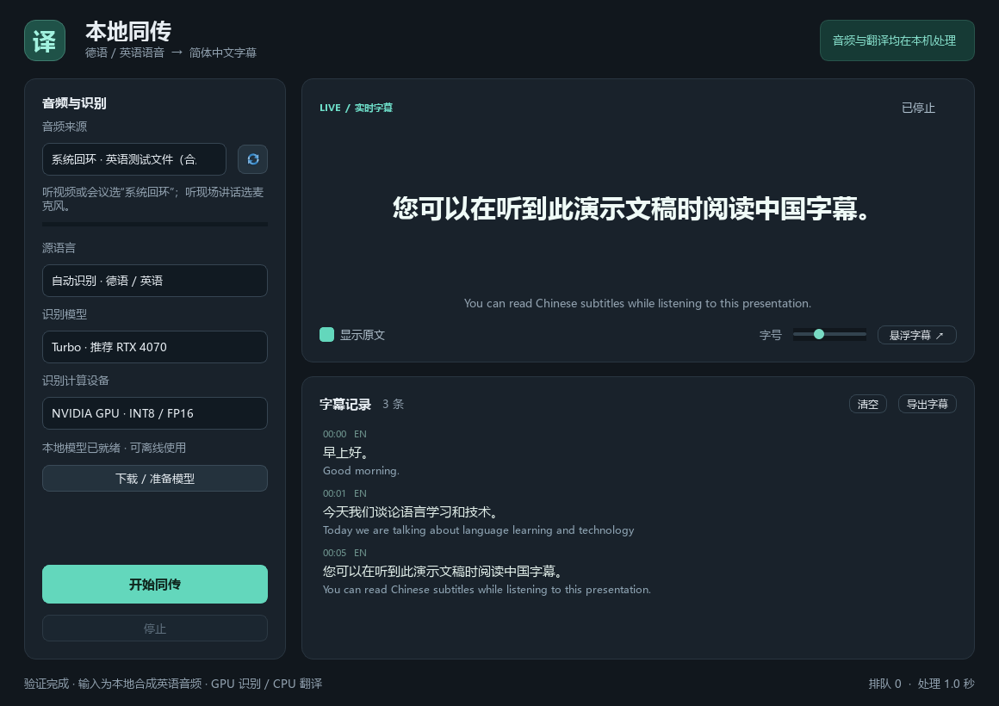
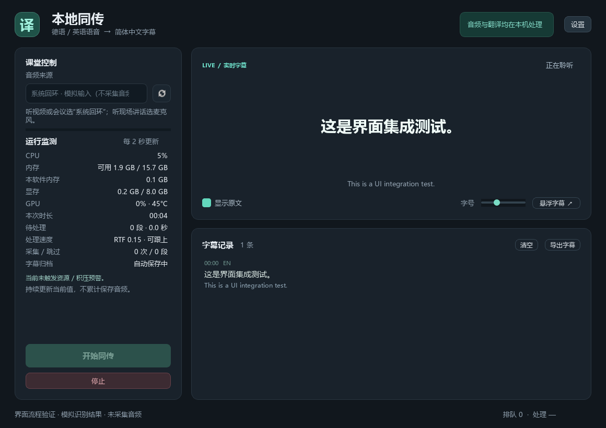

# 本机验证记录

初次验证：2026-10-27；设置 / 性能监测 / 长课回归更新：2026-10-28；默认麦克风与耗时分解：2026-10-29。Windows，Python 3.12.7，RTX 4070 Laptop 8GB，NVIDIA 驱动 572.83。

## 验证结果

- 独立 `.venv`：**269 项测试、17 项子测试通过**。本轮未新增依赖；此前 `pip check` 无依赖冲突。
- cuDNN 9.5.1 可加载，cuBLAS 创建 GPU 句柄成功。
- 已枚举 Realtek 系统声音回环和麦克风；应用不会在启动时自动录音。
- Whisper Large v3 Turbo 权重 SHA256：`e76620f83d5f5b69efd3d87e3dc180c1bd21df9fbebacfd4335e5e1efcc018da`。
- M2M100 INT8 的固定版本及全部 8 个文件已校验，记录在模型的 `provenance.json`。
- 英语合成语音 9.868 秒，GPU 识别 + CPU 翻译，导出 3 条中文 SRT；德语真人发音“guten Morgen”样本约 2.2 秒，GPU 链路导出“早安!”。
- 完整桌面流程通过：加载模型 → GPU 预热 → 输入回调 → 断句 → 识别 → 翻译 → 字幕记录 → 停止时尾句处理 → SRT 导出。
- 长字幕在 900px 窗口、46px 字号下的换行，以及悬浮窗口边界已检查。

桌面验证使用测试文件替代采集回调，**没有录制用户现场声音**。后续已用本地生成的数字静音验证真实 WASAPI 回环采集，见下节；采集、重采样、丢帧恢复和停止流程另有模拟设备测试。

## 音频溢出修复验证

旧版在打开采集流后才首次导入 `scipy.signal`，本机冷导入观察值约 1.259 秒，超过约 1 秒的原始采集队列。此外，PortAudio 的 `paInputOverflow` 状态被直接升级为停止采集，错误地统一提示关闭高负载程序。

当前在打开音频流前完成重采样初始化，原始队列保留约 5 秒的有限缓冲；短暂驱动溢出继续采集，队列拥堵保留新音频并补齐已知丢帧时间，提示最多每 3 秒更新一次。驱动未提供有效 ADC 时间戳时，丢帧数量无法精确获知，程序不会虚构精确补时。界面在实际音频流启动后才显示“正在聆听”。

真实声卡验证：默认 Realtek 系统声音回环，48kHz 双声道，使用本地生成的静音播放信号。初始化 1.063 秒，约 5 秒观察窗口内收到 4.9 秒音频，驱动溢出、队列丢帧及错误均为 0。仅统计计数和音量，没有保存或转写现场声音。结果见 [采集验证 JSON](validation-audio-recovery.json)。

## 样例处理时间

最后一次桌面验证中，3 段英语音频的识别加翻译分别耗时 **1.735 / 0.859 / 1.000 秒**。总处理时间与音频时长之比为 **0.364**。包含模型加载和 GPU 预热的整次测试约 30.8 秒。

这些是此前低延迟档短样例的观察值。当前默认智能档还需收集上下文并等待自然停顿，连续讲话最长约 8 秒（低延迟档 5 秒），处理时间不等于用户感知的端到端延迟。开始后应等待“正在聆听”再播放内容。

轻量 M2M100 翻译仍可能措辞生硬或出错。例如样例将“Chinese subtitles”译为“中国字幕”。逐句处理已修复该样例中合并多句导致问候语遗漏的问题。

详细数据见 [桌面验证 JSON](validation-desktop.json)、[文本翻译 JSON](validation-translation.json)。音频来源和许可见 [测试样本说明](../tests/fixtures/README.md)。

## 设置、性能面板与长课保护

语言、识别模型、计算设备和下载按钮已移入设置。主面板每 2 秒读取 Win32 / NVML 数据，无新监测依赖，也不额外加载推理模型。

本轮真实 Qt / Controller 集成验证使用模拟识别结果、不采集音频，以避免额外占用正在使用的模型资源。验证了设置查看与运行中锁定、真实资源采样、逐条 SRT 自动保存、关闭时等待推理线程与监测线程释放。另模拟磁盘写入失败，验证提示可见且字幕继续保留，可手动导出。也修正了延迟关闭窗口时应显式忽略关闭事件的问题。

最新一次实际采样：本机总内存约 15.7 GiB、可用约 1.9 GiB，整卡显存约 0.2 / 8.0 GiB，GPU 45°C。此前约 1.1 GiB 可用内存时，面板正确显示余量提示。集成验证进程只运行界面和监测，约 96 MiB 工作集，不代表加载模型后的内存占用。画面中的 RTF 和字幕为模拟值，完整数据见 [面板验证 JSON](validation-dashboard.json)。

加速 90 分钟流式测试覆盖真实分段器、采样连续性、固定缓冲边界与完整字幕导出；监测采样器另模拟 2,701 次轮询，检查状态不随时间增长。字幕自动归档使用 1,080 条追加记录测试，保存时间轴跨越 90 分钟。未将这些测试描述为真实模型和声卡连续运行 90 分钟。详见 [长课审查](long-session-review.md)。

## 用户选定的优化与加载方案分析

已移除自动语言检测：界面首次要求显式指定德语或英语并持久化，识别 API 和文件 CLI 也拒绝自动模式。设置恢复不触发误保存，写盘失败不会阻止本次选择使用。翻译候选降为 1，识别候选保持 3，默认识别模型仍为 Turbo。

真实 CPU 翻译对照的正常样本中，8 线程语料中值约 2.004 秒，6 线程约 2.288 秒；默认采用 8，保留 4 / 6 选项。异常停顿没有隐藏或作为速度排名依据。样本、原始数据、CPU / 内存取舍及尚未进行 90 分钟温控验证的限制见 [线程实测](validation-cpu-tuning.md)。这些数据只比较线程配置，未测量 beam 2 → 1 对全链路速度的独立提升。

此前对重复加载的方案分析见 [模型加载方案](model-lifecycle-options.md)。随后用户已自行完成暂停 / 继续与结束释放：同课继续复用模型，新课程开始仍加载；本次托盘字幕修复保留该行为。

## 托盘期间的独立置顶字幕

基于用户自行完成的暂停 / 继续与托盘功能，仅调整了字幕窗口和托盘显示逻辑。字幕窗口不再以主窗口作为原生 owner，避免主窗口最小化时字幕被连带隐藏；保留 Tool 与 WindowStaysOnTop 标志，并设置不抢焦点显示、字幕关闭不退出主程序。主窗口销毁或应用真正退出时显式清理独立字幕窗口。

真实 Controller 集成回归覆盖“最小化”“收起到托盘”“关闭按钮”三种入口：课程中自动显示字幕，隐藏主窗口期间收到的新字幕继续更新；恢复主窗口正常；手动关闭字幕不会被新字幕强制重开；托盘菜单与主界面开关同步，退出后字幕与监测线程均关闭。测试使用模拟推理与托盘，无音频采集或新模型加载。

另用本机 Windows 原生窗口平台检查：主窗口最小化 / 隐藏时，字幕的原生窗口仍可见；原生扩展样式包含 TOPMOST 与 TOOLWINDOW，字幕 owner 不是主窗口；显示字幕前后前台窗口句柄相同；退出后字幕关闭。全部检查通过，见 [原生窗口验证 JSON](validation-tray-overlay.json)。该验证不表示能够覆盖独占全屏或系统安全桌面。

## 手动五分钟诊断采样

为后续比较识别质量增加了显式开启的采样功能，识别参数保持不变。单元测试验证精确 300 秒的帧数上限、最后一个包截断、空闲设备的实际时间截止、WAV 头收尾、开启前不保存、队列拥堵和写盘异常隔离。引擎测试验证采样起点、课程 / WAV 时间偏移、原文保存及暂停结束后不隐式续录。

真实 Qt / Controller / 后台写盘集成测试使用合成输入与模拟识别，验证界面手动开始 / 停止、音频和参数文件产生、停止采样不结束课程以及退出清理。没有采集用户现场声音，也没有加载第二套识别模型。实际本课识别质量仍需用户手动采集的素材，当前分析与轻量 VAD 对照见 [识别质量排查](asr-quality-review.md)。

## 10 月 28 日素材对照与描述句切分（历史记录）

用户随后主动提供了约 5 分钟诊断素材并确认现场英语课的部分术语。已在本机离线比较原分段、关闭内层 VAD、较长上下文、7 秒自然断句、beam 5 和术语提示。每次仅一套额外模型，无联网上传；全部比较进程已退出。没有完整人工听写参考，因此只给候选文本与计算耗时，不给词错误率或准确率提高百分比。

用户指出实际难点是普通叙述，已撤回此前术语输入功能。新一轮保持原模型、量化、beam 3 和两层 VAD，仅对照音频上下文与断句。3 秒音频回看 + 词时间裁剪耗时较高且可能漏掉边界词，未实施。8 秒 / 0.8 秒重分段在几处描述上更连贯，仍有错词；设为默认“连贯优先”，同时在设置与 CLI 保留原 5 秒 / 0.5 秒“低延迟”。没有完整人工参考，不宣称准确率提高百分比。

测试覆盖两档 90 分钟加速流的固定内存边界、时间轴和导出，设置恢复 / 保存 / 课程期间锁定，引擎与文件转译参数，以及诊断中记录实际分段参数。包含课堂文字的原始比较报告只保存在被忽略的 diagnostics/ 目录。细节见 [识别质量排查](asr-quality-review.md)。

## 默认麦克风与延迟诊断（2026-10-29）

默认设备改为 Windows 默认麦克风，其次其他麦克风；没有麦克风才回退至默认系统回环 / 其他可用设备。手动选中的设备在刷新时仍可用则保留，设备编号不跨启动持久化。真实 Controller / UI 集成测试覆盖设备移除、无麦克风、无设备和手动选择保留，并断言选择期间没有启动模型或采集。

用户反馈本次收音较好、准确度较高，但原文与中文字幕都晚出现。目前两者在翻译完成后一起发出，因此不能单凭显示时机确定 ASR 慢。本轮保留当前模型、量化、候选数与断句，仅增加最新一段的识别 / 翻译耗时显示、队列等待提示与手动采样的 latency.jsonl。

分段器仅增加一个采样时间标记 available_at，不改变样本或切分。推理队列的每项仅增加入队时钟，队列仍最多 3 段；正常会话仅保留最新指标，无累计耗时数组。ASR 原文仍在翻译前写入 transcripts.jsonl；耗时另在发出字幕后写入 latency.jsonl，并用片段起止时间对应。无识别 / 无翻译的片段同样标记结果，避免只观察成功字幕。

断句等待是“保留音频末尾到确认切段”的媒体时间差，另保存 audio_seconds；连续讲话达到 8 秒时这个差可以为 0，但开头词已等待这 8 秒采集，不能解释成零延迟。排队、ASR、翻译和入队至发出由单调时钟分别记录，不包含声卡 / 采集队列、转换和 GUI 绘制。停止诊断后不补收迟到事件，因此末尾在途结果可能缺失。

测试使用假时钟分离排队 / ASR / MT，验证静音不调用翻译、未知指标不显示虚假 0、前后采样隔离、两个 JSONL 文件 / 计数 / 收尾及拥堵异常隔离。已用模拟数据检查 [面板截图](screenshots/dashboard-latency.png) 的布局；该图不是本机模型性能测量。本轮没有额外录音、模型加载或新课堂速度基准，等待用户提供新五分钟素材后再调整延迟与质量取舍。

## 新五分钟素材后的智能断句（2026-10-29）

用户随后完成新采样，300 秒 WAV 完整，55 条原文与 55 条分项耗时。采样内成功字幕 49 条的处理耗时中位约 1.094 秒，全部记录的排队与丢失计数为 0，主要等待来自收集较长语音段。保持同一 Turbo / INT8-FP16 / beam 3、CPU INT8 翻译 8 线程及双层 VAD，比较自然停顿与固定短段。

交付的 adaptive 默认档保留约 4.5 秒上下文后，允许 0.3 秒自然停顿提前处理；短句仍用 0.8 秒，连续讲话仍最多 8 秒。旧 coherent 与 fast 档仍可选择，已保存偏好保留，缺失 / 非法偏好采用 adaptive。生产参数得到 59 个片段，与独立候选的全部起止 / 出段时间一致。片段可有极少量预卷 / 尾部静音重叠，不宣称所有自然停顿片段的时间戳严格不重叠。

最终单套 ASR + MT 离线串行回放估计，按 VAD 有声帧计的字幕等待平均 4.41 → 3.87 秒，P90 7.77 → 6.63 秒；总推理耗时 39.97 → 40.79 秒。它不含硬件 / 采集队列 / GUI 延迟，不是逐词人工对齐，不是实时复测，也不是通用提速或功耗承诺。按用户最后要求，清晰档仅依据本次素材选择：4 秒平均仅再省约 0.15 秒，却使本次 HR 等描述破碎且耗时较高，保留 4.5 秒。设置名称明确为“清晰收音（实时优先）”与保留原参数的“较差收音（长上下文）”，后者本轮不再调参。仍有局部措辞 / 漏句变化风险，未声称准确率不变或给出 WER。

最初额外 ASR 对照遇到 768 MiB 可用内存保护时主动停止，部分候选记录保留为未完成；用户释放原会话模型后，最终双素材对照完整完成，所有测试模型已退出释放。没有上传音频、下载依赖或增加软件常驻模型。

测试覆盖可选参数配对 / 范围 / 非有限值，短句仍等待普通停顿、达到上下文后提前出段、连续讲话硬上限、暂停及尾句时间轴、三档偏好与诊断路由，以及三档各 90 分钟加速分段与完整导出。新设置页面见 [截图](screenshots/settings-adaptive.png)。完整素材比较报告保留在被忽略的 diagnostics/ 目录。

## 可选仅原文字幕（2026-10-29）

设置增加“翻译为中文字幕”，默认开启以保留既有行为；关闭后 translate_enabled=false 严格按布尔值持久化。仅原文模式跳过翻译模块导入、模型构造 / 加载 / 调用与清理，只加载并复用识别模型，识别后将同一原文放入主字幕。主界面大字幕、悬浮字幕、历史、SRT / TXT 与自动归档均可用，重复的原文副行被省略。“显示原文”开关不会令原文主字幕消失。

模型就绪检查与界面准备命令均按模式区分：仅原文不要求翻译模型文件，下载准备增加 --asr-only；离线文件字幕增加 --no-translation。关闭时翻译线程控件禁用，课程进行与暂停期间不可切换翻译模式，先结束并释放再修改。诊断 metadata 记录翻译是否启用，latency.jsonl / 实时指标以 translate_enabled=false、translation_seconds=0 明确区分禁用，面板显示“关闭”。

原五分钟素材中，成功片段翻译耗时中位约 0.360 秒；省去的是这一串行阶段及其资源占用，仍需收集音频、断句与识别，不能承诺逐字即时或固定加速幅度。本轮未重新加载真实模型作资源 / 速度基准，也没有录制新音频。

测试证明翻译模块不可导入时原文流水线仍运行、没有创建 MT、ASR 暂停续录复用与尾句保留；原默认中文模式仍通过。真实 Controller / UI 测试仅提供识别模型假文件、不提供翻译模型，验证模式切换即时改变就绪状态、原文主字幕 / 悬浮 / 历史只显示一次、SRT / TXT / 自动归档与偏好保存。另覆盖 CLI 仅原文实际文件输出、仅准备识别资产及旧配置默认启用翻译。全部测试使用模拟输入 / 推理，无真实录音或下载。[设置截图](screenshots/source-only-settings.png) 与 [主字幕截图](screenshots/source-only-dashboard.png) 使用模拟内容。
